# Set Up SAP AI Core and Deploy the RPT 1.6 Model

Subscribe to SAP AI Launchpad and SAP AI Core using BTP Boosters, then deploy the **SAP RPT 1.6 Large** model so it is available as a running inference endpoint for the CAP application.

## What You Will Learn

- How to run the **Set Up Account for SAP AI Launchpad** booster
- How to run the **Set Up Account for SAP AI Core** booster
- How to connect SAP AI Launchpad to your AI Core instance
- How to find and deploy the **SAP RPT 1.6 Large** model from the Model Library
- How to verify the deployment is running and copy the inference URL

## Prerequisites

- SAP BTP global account with administrator access
- A subaccount named **Building Custom AI Solutions** with Cloud Foundry enabled and a `dev` space provisioned (completed in Step 00)

---

## Part 1 — Set Up SAP AI Launchpad

### Step 1.1 — Run the Booster

1. Navigate to your global account and choose the **Boosters** tile.
2. Search for and select **Set Up Account for SAP AI Launchpad**, then choose **Start**.

   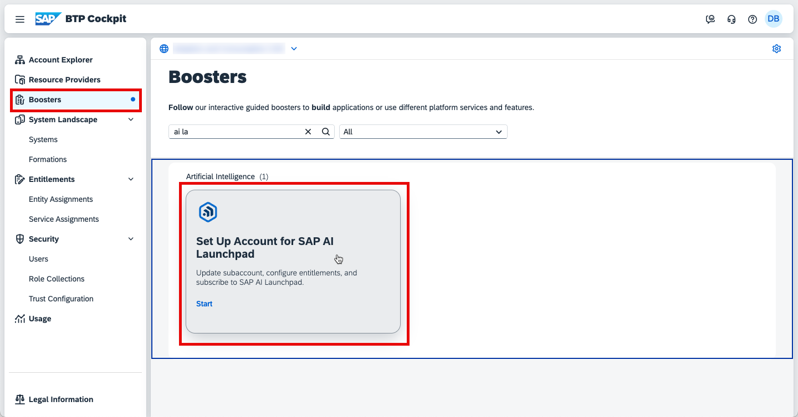

3. Confirm that all required prerequisites are met and choose **Next**.

   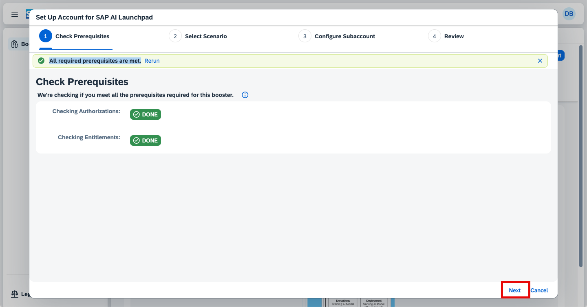

### Step 1.2 — Configure the Subaccount

4. Select **Select Subaccount** mode and choose **Next**.

   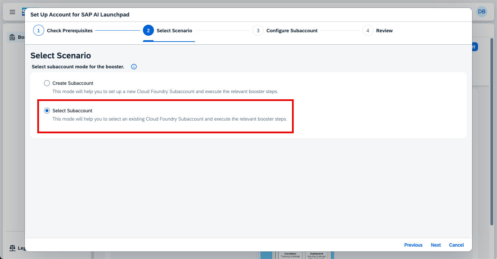

5. Configure the Cloud Foundry subaccount and space as follows, then choose **Next**:

   | Field          | Value                          |
   | -------------- | ------------------------------ |
   | **Subaccount** | `Building Custom AI Solutions` |
   | **Org**        | `building-custom-ai-solutions` |
   | **Space**      | `dev`                          |

   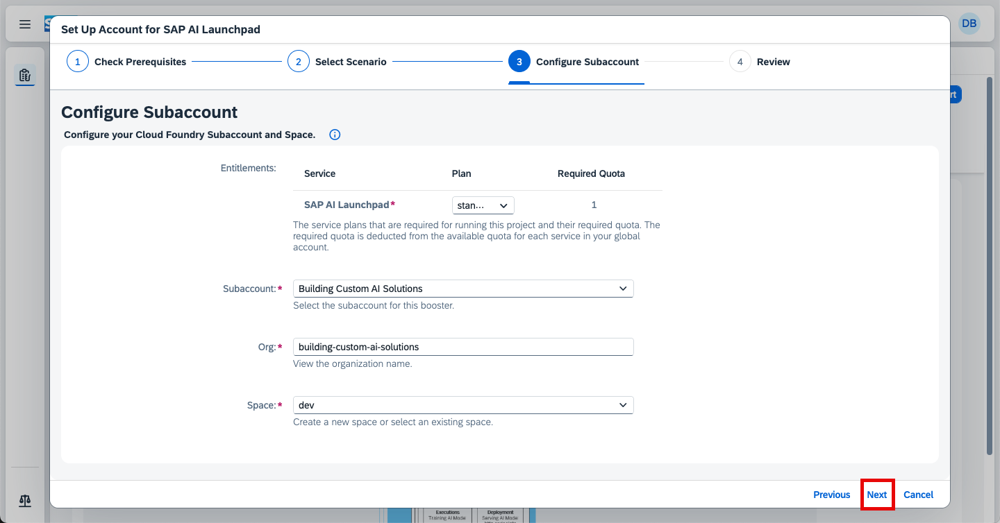

6. Choose **Finish**.

### Step 1.3 — Verify Access

7. Navigate to your subaccount → **Instances and Subscriptions**. Open **SAP AI Launchpad** in an incognito window.

   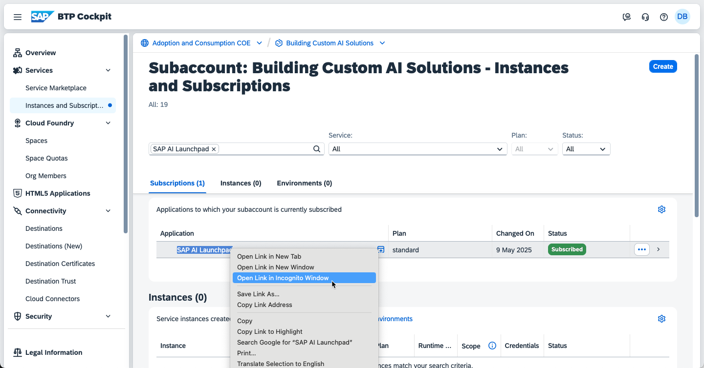

   Log in with your IAS user. You should see the **SAP AI Launchpad** homepage with no AI API connections yet. Keep this tab open.

   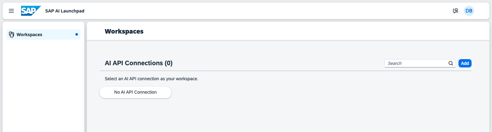

   > **Tip:** If a _Forbidden_ error appears, confirm your user has the following role collections assigned:
   >
   > - `ailaunchpad_aicore_admin_editor`
   > - `ailaunchpad_allow_all_resourcegroups`
   > - `ailaunchpad_connections_editor`
   > - `ailaunchpad_functions_explorer_editor`
   > - `ailaunchpad_mloperations_editor`
   >
   > 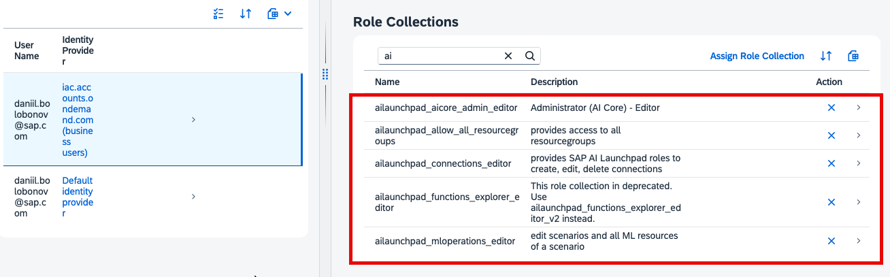

---

## Part 2 — Set Up SAP AI Core

### Step 2.1 — Run the Booster

1. Navigate to your global account and choose the **Boosters** tile.
2. Search for and select **Set Up Account for SAP AI Core**, then choose **Start**.

   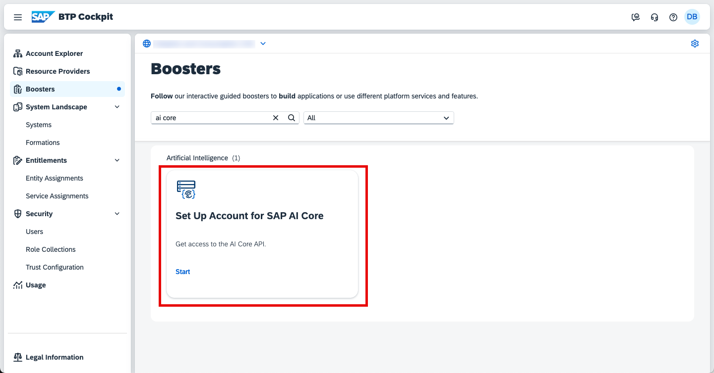

3. Confirm that all required prerequisites are met and choose **Next**.

   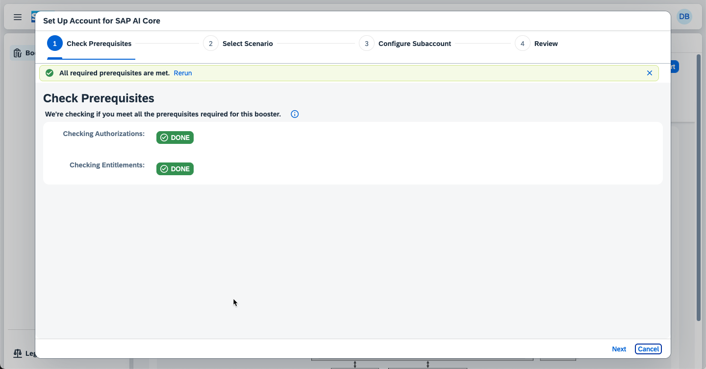

### Step 2.2 — Configure the Subaccount

4. Select **Select Subaccount** mode and choose **Next**.

   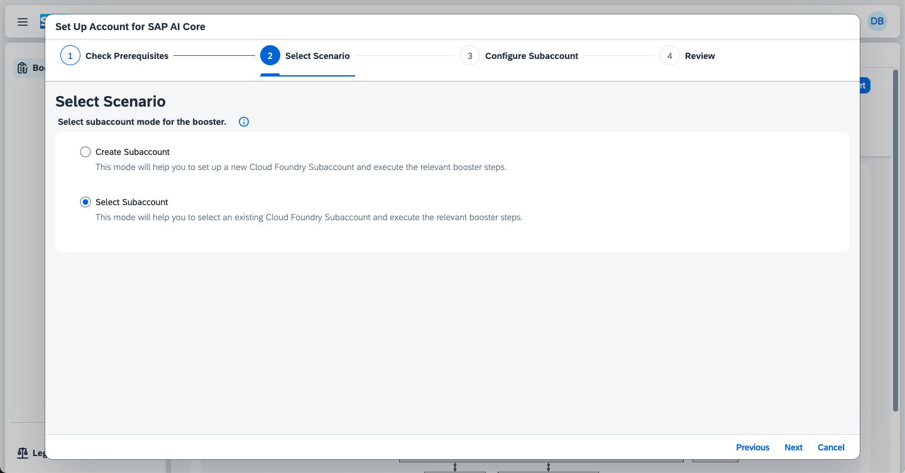

5. Configure the Cloud Foundry subaccount and space as follows:

   | Field          | Value                          |
   | -------------- | ------------------------------ |
   | **Plan**       | `extended`                     |
   | **Subaccount** | `Building Custom AI Solutions` |
   | **Org**        | `building-custom-ai-solutions` |
   | **Space**      | `dev`                          |

   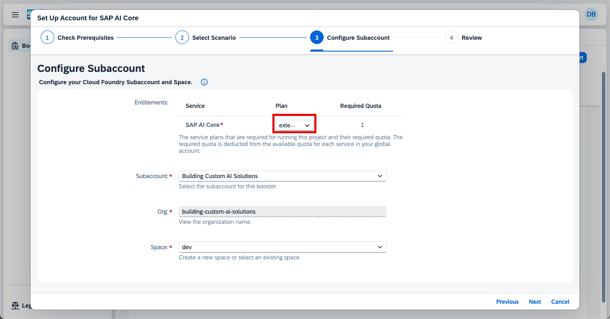

   Choose **Next**, then **Finish**.

### Step 2.3 — Download the Service Key

6. Navigate to your subaccount → **Instances and Subscriptions** and filter for `SAP AI Core`. Open the **Credentials** key created by the booster.

   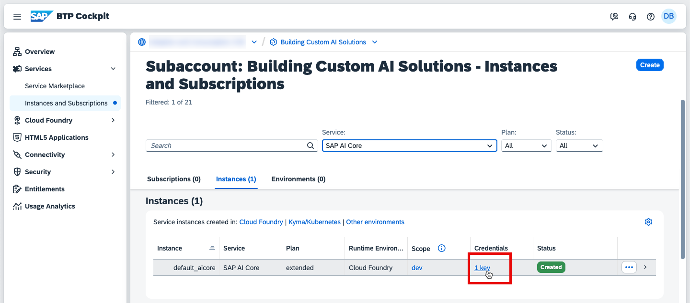

7. Choose **Download** to save the service key JSON to your machine. You will need it in the next step.

   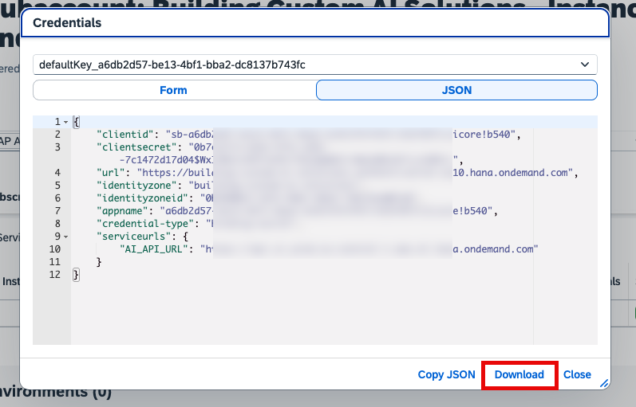

### Step 2.4 — Connect AI Launchpad to AI Core

8. Return to the **SAP AI Launchpad** tab and choose **Add** to add a new connection.

   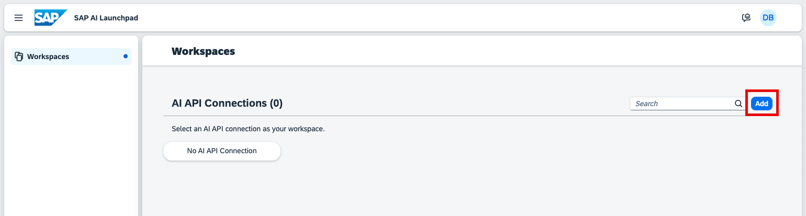

9. Click the **Upload** icon and select the service key JSON you downloaded. The connection fields populate automatically. Enter `default` as the **Connection Name** and choose **Create**.

   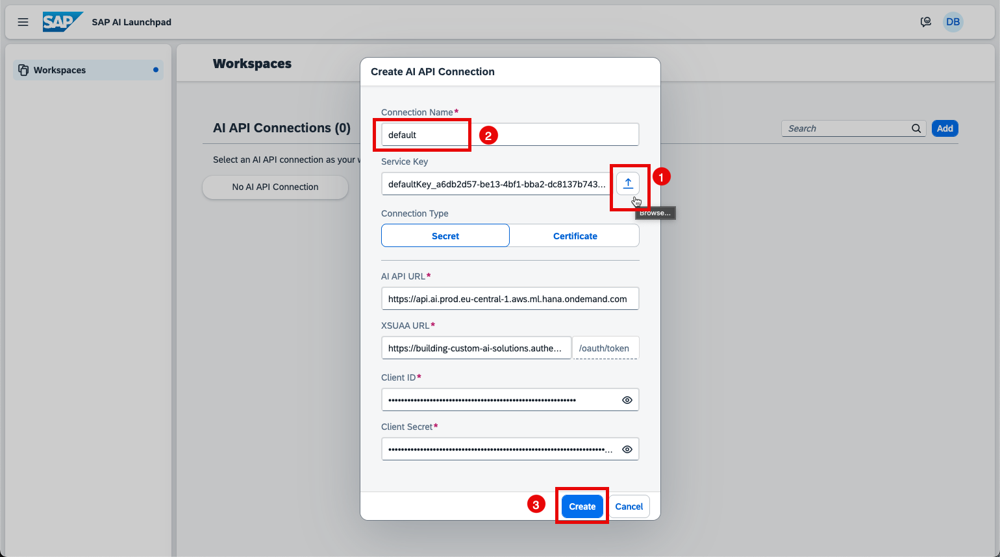

10. The workspace is set automatically. A `default` resource group appears under **Resource Groups**.

    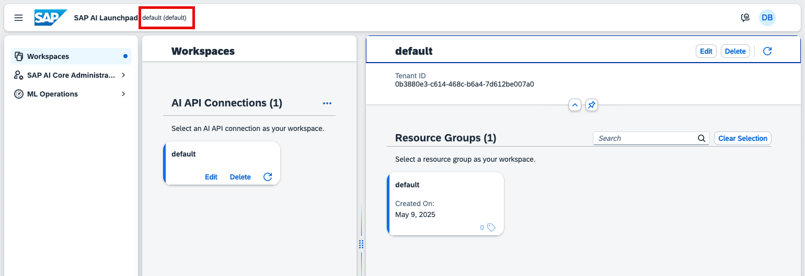

    > **Note:** The default resource group is created automatically by the booster. Resource groups isolate AI workflows and connect them to the required computing resources.

---

## Part 3 — Deploy the SAP RPT 1.6 Large Model

### Step 3.1 — Open the Model Library

1. In SAP AI Launchpad, expand the **Generative AI Hub** section in the left panel and choose **Model Library**.

   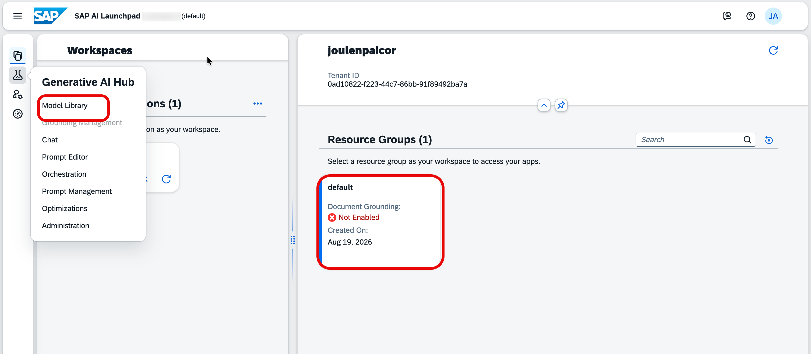

### Step 3.2 — Find the SAP RPT 1.6 Large Model

2. In the Model Library, filter by **SAP Managed** under **Model Provisioning**. Locate and click the **SAP RPT 1.6 Large** (`sap-rpt-1.6-large`) card.

   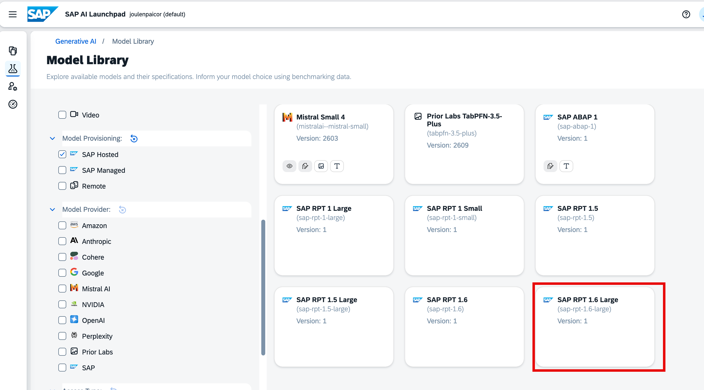

### Step 3.3 — Deploy the Model

3. On the **Model Details** page, choose **Deploy** in the top-right corner.

   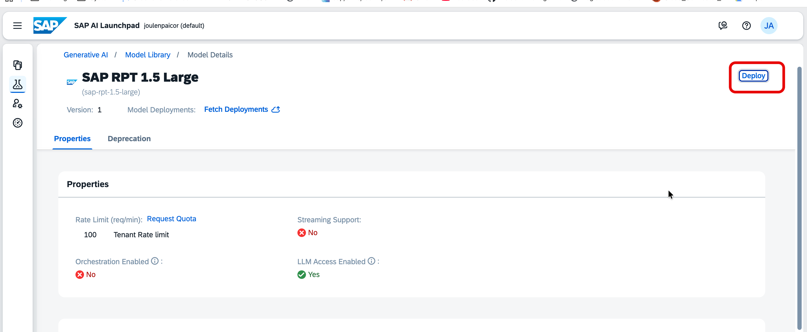

   The deployment is created automatically using an auto-generated configuration. No additional configuration is required.

### Step 3.4 — Verify the Deployment is Running

4. Navigate to **ML Operations** → **Deployments** in the left panel.

   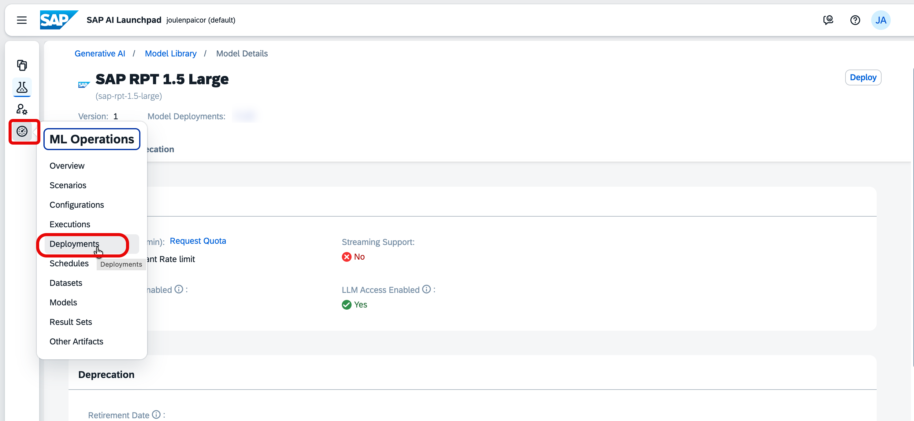

5. Confirm that a deployment with configuration `sap-rpt-1.6-large_autogenerated` shows a **RUNNING** status.

   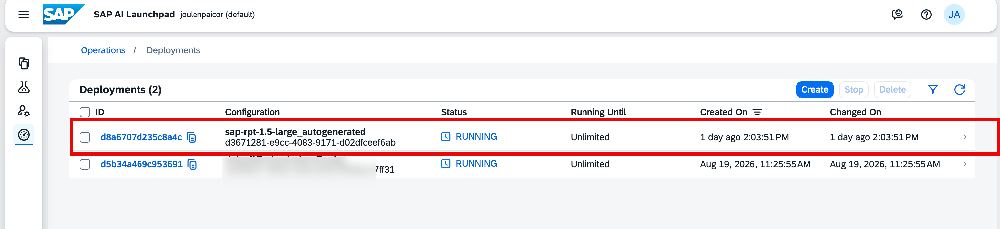

### Step 3.5 — Copy the Inference URL

6. Click the deployment ID to open its details. Copy the **URL** field — this is the inference endpoint used by the CAP application to call the model at runtime.

   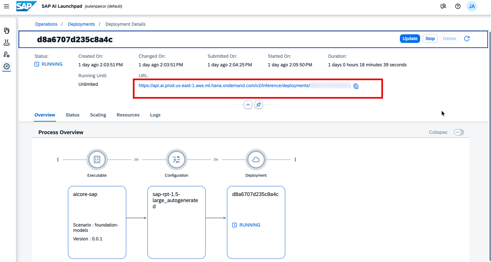

---

## Troubleshooting

| Symptom                                       | Resolution                                                                                  |
| --------------------------------------------- | ------------------------------------------------------------------------------------------- |
| _Forbidden_ error when opening AI Launchpad   | Assign the five required `ailaunchpad_*` role collections to your user (see Step 1.3)       |
| Booster fails at prerequisites check          | Confirm the subaccount has Cloud Foundry enabled and a `dev` space exists                   |
| Service key upload does not populate fields   | Ensure you downloaded the key as JSON, not YAML; re-download from the BTP Cockpit if needed |
| Deployment stays in **Pending** status        | Wait up to 5 minutes; the first deployment provisions compute resources and takes longer    |
| Deployment shows **Dead** or **Error** status | Open the deployment and check the **Logs** tab for the root cause                           |

---

## Summary

You have successfully:

- Subscribed to SAP AI Launchpad and SAP AI Core using BTP Boosters
- Connected SAP AI Launchpad to your AI Core instance using the service key
- Deployed the **SAP RPT 1.6 Large** (`sap-rpt-1.6-large`) model from the Model Library
- Confirmed the deployment is **RUNNING** and noted the inference URL

The model is now ready to serve inference requests. The CAP application deployed in Step 03 will call this endpoint via the SAP AI Core SDK to perform demand forecast analysis.
