# Configure SAP Build Work Zone to Embed the Forecast Applications

Create a Work Zone site and embed the two Fiori applications — **Forecast Run Application** and **Forecast Result** — that were deployed to the HTML5 Application Repository in Step 04.

## What You Will Learn

- How to open the SAP Build Work Zone Site Manager from the BTP Cockpit
- How to create a site named **Demands**
- How to refresh the HTML5 Apps content channel so deployed apps are discoverable
- How to use the Content Explorer to import both apps in one step
- How to assign the apps to the `Everyone` role for universal access
- How to create a group and organise the app tiles
- How to verify the finished site and launch an application at runtime

## Prerequisites

- SAP Build Work Zone, standard edition is subscribed in your BTP subaccount and the `Launchpad_Admin` role collection is assigned to your user (completed in Step 00)
- Both Fiori applications are deployed and visible under **HTML5 Applications** in the BTP Cockpit (completed in Step 04)

---

## Part 1 — Open the Work Zone Site Manager

1. In the [SAP BTP Cockpit](https://cockpit.btp.cloud.sap), navigate to your subaccount.
2. Go to **Services** → **Instances and Subscriptions**.
3. Under **Subscriptions**, click **SAP Build Work Zone, standard edition** to expand its details, then click **Go to Application**.

   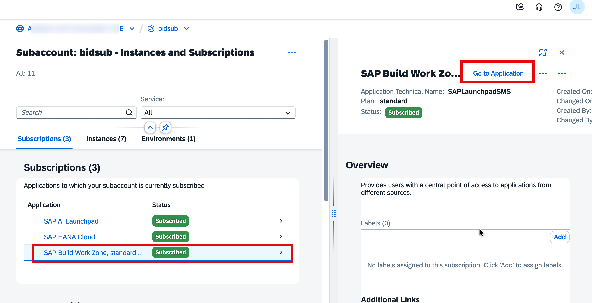

The **Site Directory** opens. This is the central administration hub for all Work Zone sites.

---

## Part 2 — Create a New Site

In the Site Directory, click **Create Site**.

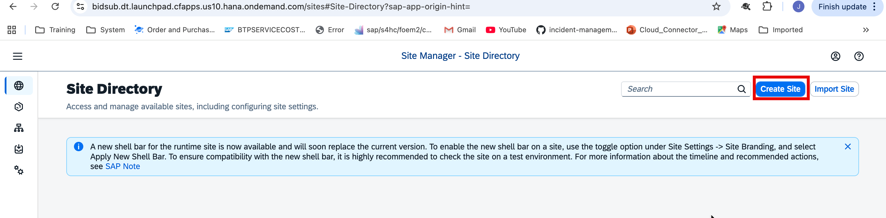

In the **Create Site** dialog, enter `Demands` as the site name and click **Create**.

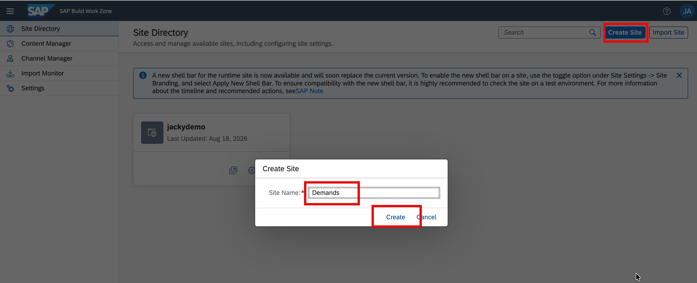

---

## Part 3 — Refresh the HTML5 Apps Content Channel

Before importing apps, update the HTML5 Apps channel so it reflects the latest state of the HTML5 Application Repository.

1. Click the **Channel Manager** icon (third icon) in the left-side panel.
2. In the **HTML5 Apps** row, click the **Refresh** icon (circular arrow) in the **Actions** column.

   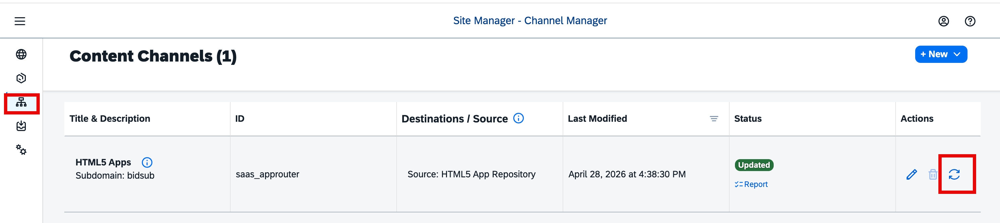

Wait until the **Status** column shows **Updated** before proceeding.

---

## Part 4 — Import the Apps via Content Explorer

The Content Explorer lets you browse the HTML5 Application Repository and add both apps to your site in a single operation — no manual app configuration required.

### Step 4.1 — Open the Content Manager

Click the **Content Manager** icon (second icon) in the left-side panel. In the Content Manager, click **Content Explorer**.

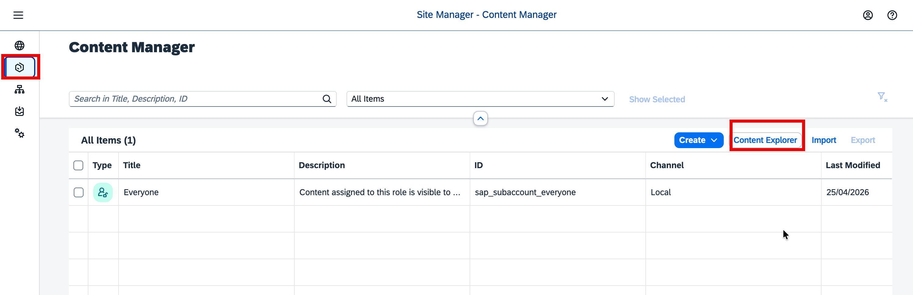

### Step 4.2 — Select the HTML5 Apps Channel

The Content Explorer shows available content channels. Click the **HTML5 Apps** tile.

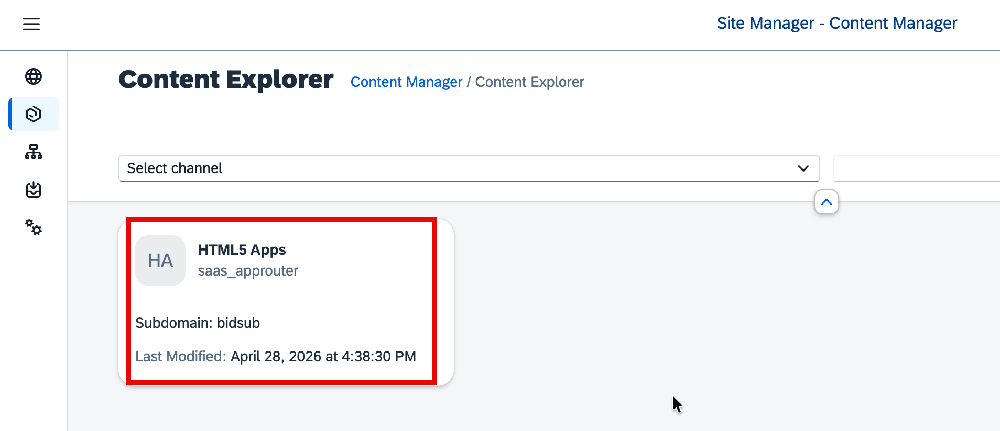

### Step 4.3 — Add Both Applications

The channel lists the two Fiori apps deployed in Step 04:

| App                      | ID               |
| ------------------------ | ---------------- |
| Forecast Run Application | `forecastrun`    |
| Forecast Result          | `forecastresult` |

Tick the header checkbox to select both apps, then click **Add**.

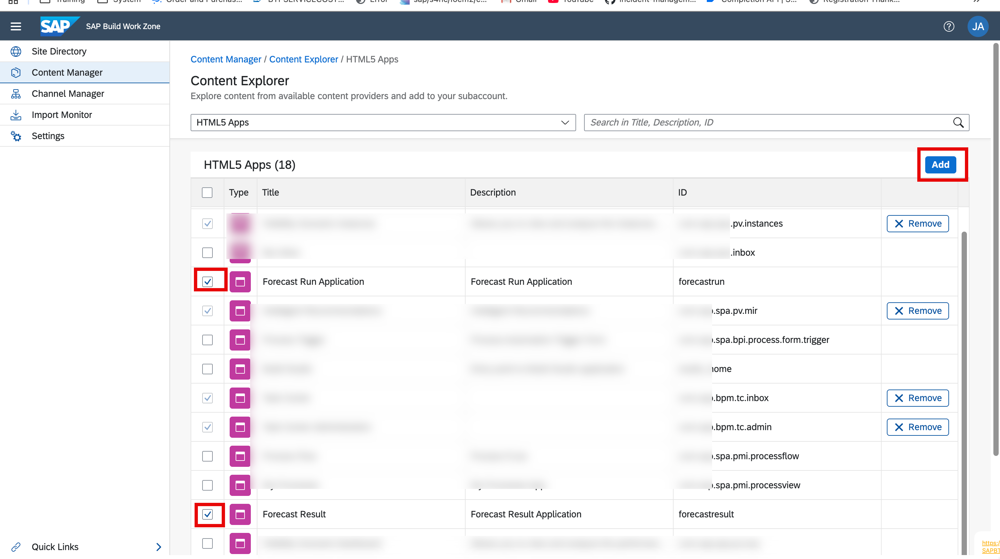

### Step 4.4 — Verify the Apps Appear in the Content Manager

Navigate back to the **Content Manager** using the breadcrumb at the top. You should now see both apps listed alongside the built-in `Everyone` role — **All Items (3)** in total.

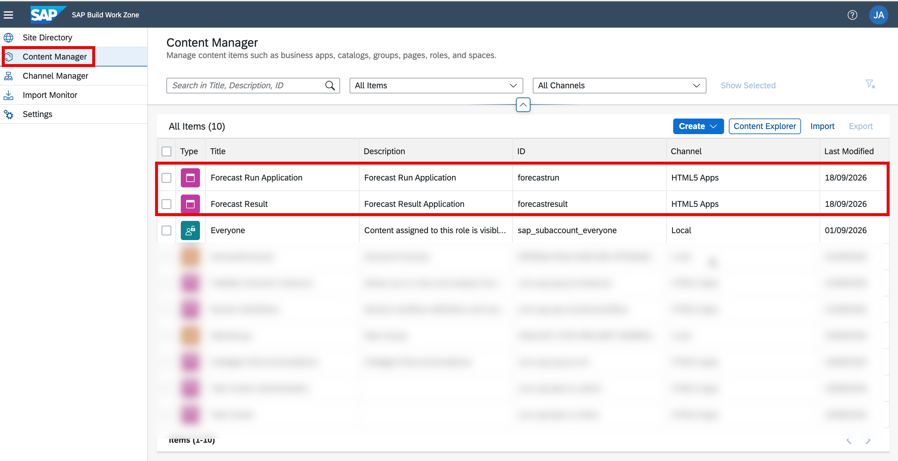

---

## Part 5 — Assign the Apps to the Everyone Role

For end users to see the app tiles at runtime, each app must be assigned to a role. The built-in `Everyone` role makes content visible to all authenticated users.

1. In the Content Manager, click the **Everyone** role.

   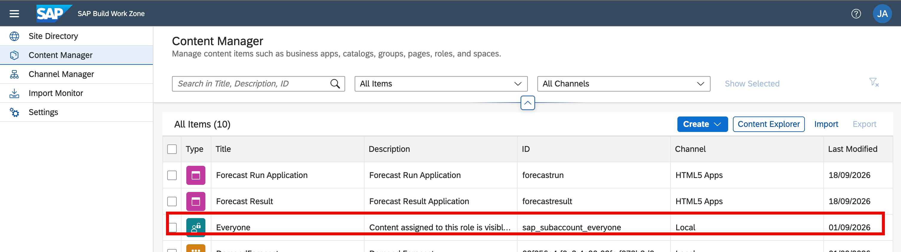

2. Click **Edit**.

3. Under the **Apps** tab, both apps are listed. Click the toggle in the **Assignment Status** column for each app to turn it green.

4. Click **Save**.

   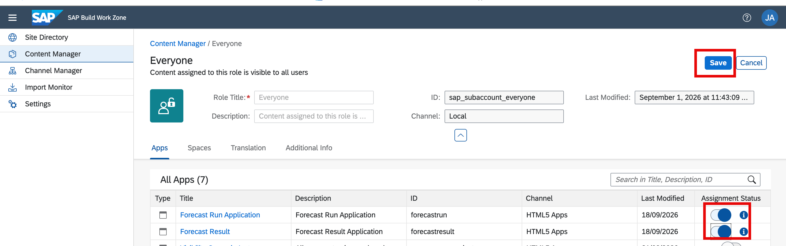

---

## Part 6 — Create a Group

Groups organise tiles on the launchpad into labelled sections that users see at runtime.

1. In the Content Manager, click **Create** → **Group**.

   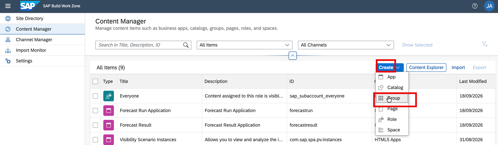

2. Enter the following values:

   | Field       | Value            |
   | ----------- | ---------------- |
   | Title       | `DemandForecast` |
   | Description | `Demand Forecast` |

3. Under the **Apps** tab, toggle the **Assignment Status** for both apps to green.

4. Click **Save**.

   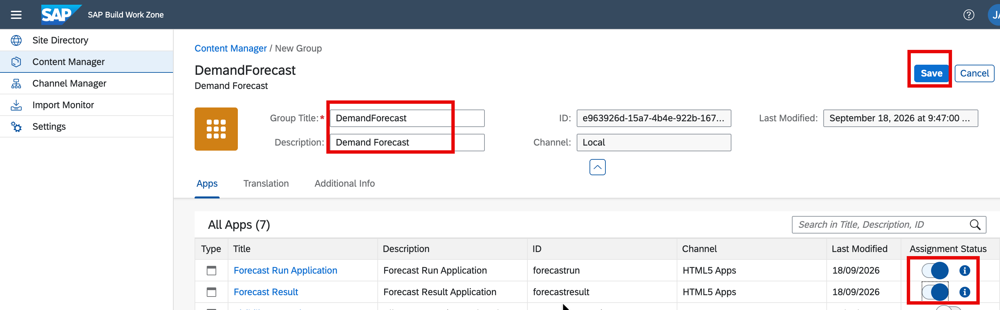

---

## Part 7 — Launch and Verify the Site

1. Click the **Site Directory** icon (first icon) in the left-side panel.
2. On the **Demands** tile, click the **Go to Site** icon (the small launch icon at the bottom of the tile).

   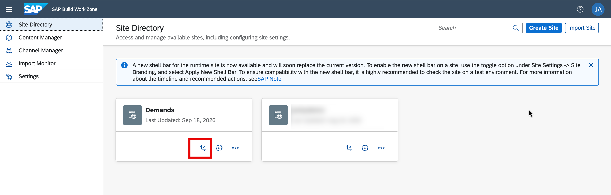

The runtime site opens in a new browser tab. Both app tiles — **Forecast Run Application** and **Forecast Result** — should appear under the **DemandForecast** group.

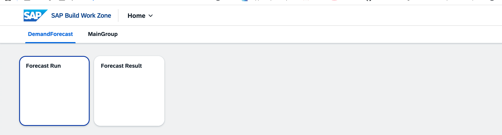

---

## Troubleshooting

| Symptom | Resolution |
| ------- | ---------- |
| Apps do not appear in the Content Explorer | Confirm the MTA deployment in Step 04 completed successfully and refresh the HTML5 Apps channel in the Channel Manager |
| Content Explorer shows the HTML5 Apps channel but it is empty | Verify the `html5-repo-host` service instance exists under **Instances** in the BTP Cockpit |
| App tiles appear but fail to load with a 403 error | Confirm both apps are toggled green under the **Apps** tab of the `Everyone` role |
| The DemandForecast group does not appear in the runtime site | Confirm the group was saved and both apps are assigned to it |

---

## Summary

You have successfully:

- Created the **Demands** Work Zone site
- Refreshed the HTML5 Apps content channel to make the deployed apps discoverable
- Imported both Fiori apps from the HTML5 Application Repository via the Content Explorer
- Assigned both apps to the `Everyone` role for universal access
- Created a **DemandForecast** group and organised both app tiles within it

Both applications — **Forecast Run Application** and **Forecast Result** — are now accessible as tiles on the Work Zone launchpad.
