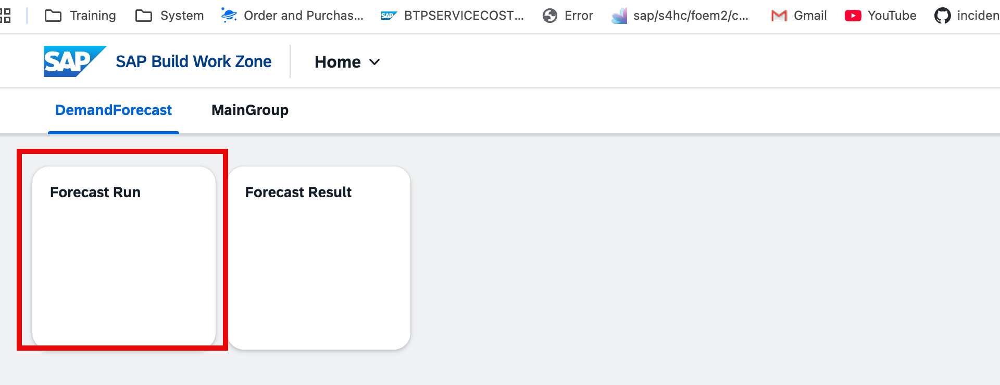
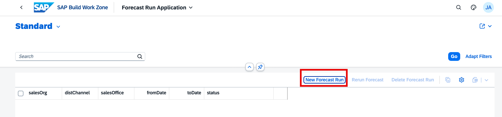
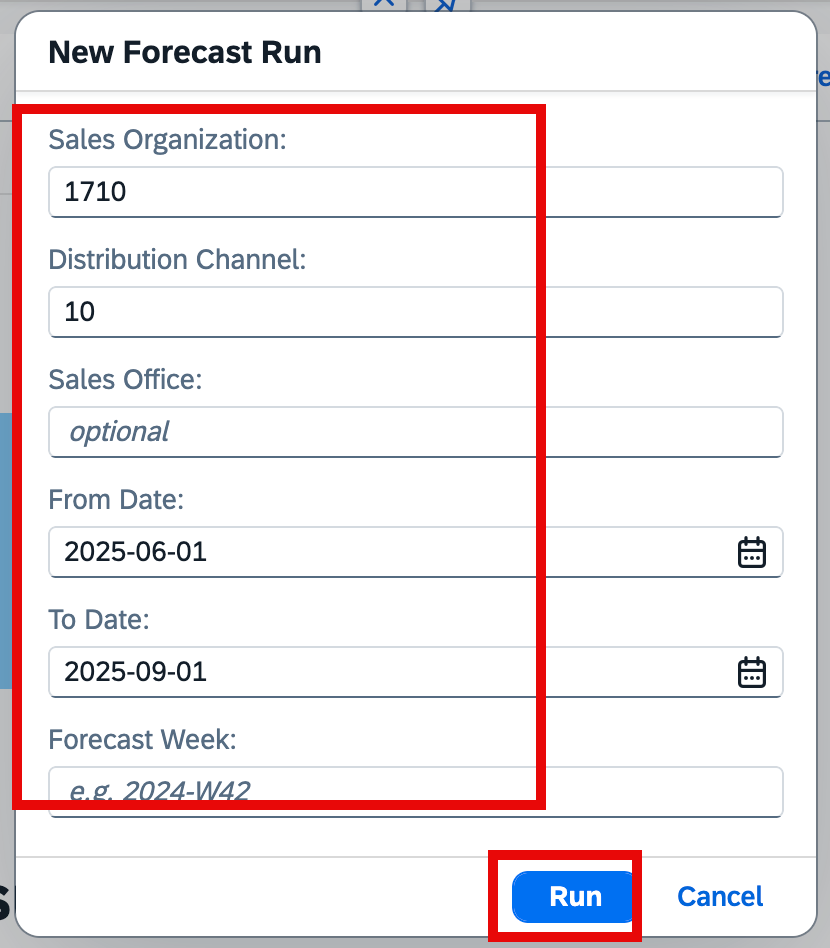
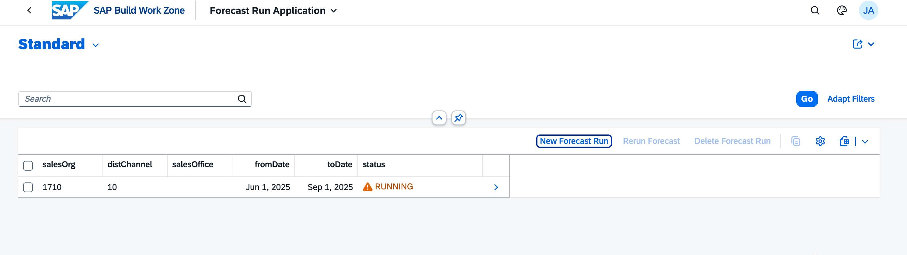
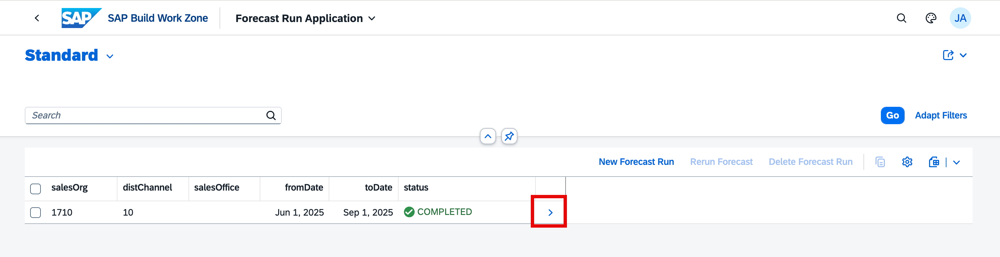
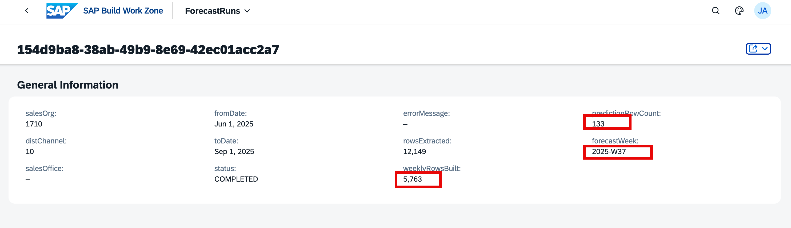
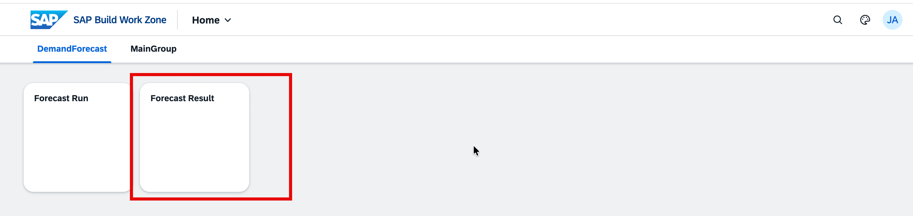
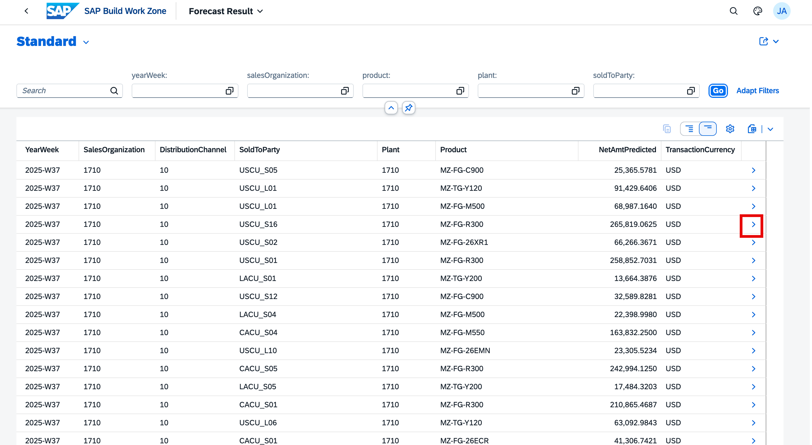
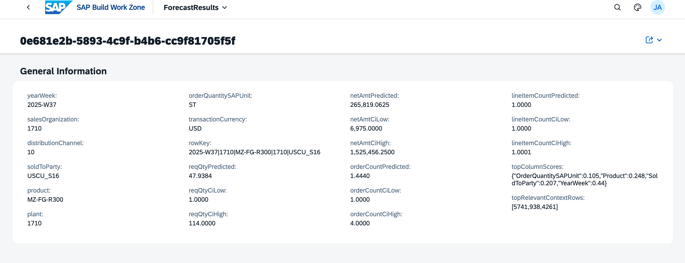

# End-to-End Test

Verify the complete solution by triggering a demand forecast run and inspecting the AI-generated predictions in the Forecast Result application.

## What You Will Learn

- How to open the Forecast Run and Forecast Result applications from the Work Zone launchpad
- How to create a new forecast run scoped to a sales organisation and date range
- How to monitor run status and interpret the run statistics
- How to browse and drill into the AI-predicted demand results

## Prerequisites

- All previous steps (01–04) completed: AI Core model deployed, S/4HANA destination configured, application deployed to Cloud Foundry, and Work Zone site configured
- Your user is logged in to SAP Build Work Zone with the `Everyone` role assigned (completed in Step 04)

---

## Part 1 — Trigger a Forecast Run

### Step 1.1 — Open the Forecast Run Application

1. Open your **SAP Build Work Zone** site and navigate to the **DemandForecast** group.
2. Click the **Forecast Run** tile.

   

### Step 1.2 — Create a New Forecast Run

3. The **Forecast Run Application** opens showing an empty list. Click **New Forecast Run**.

   

4. In the **New Forecast Run** dialog, fill in the following values:

   | Field                    | Value        | Notes                                      |
   | ------------------------ | ------------ | ------------------------------------------ |
   | **Sales Organization**   | `1710`       | Must match a sales org in your S/4HANA tenant |
   | **Distribution Channel** | `10`         |                                            |
   | **Sales Office**         | *(optional)* | Leave blank to include all offices         |
   | **From Date**            | `2025-06-01` | Start of the historical data window        |
   | **To Date**              | `2025-09-01` | End of the historical data window          |
   | **Forecast Week**        | e.g. `2025-W37` | ISO week for which to generate predictions |

   Click **Run**.

   

### Step 1.3 — Monitor the Run Status

5. The list refreshes and a new entry appears with status **RUNNING**. The pipeline is fetching sales orders from S/4HANA Cloud, aggregating them into weekly buckets, and calling the SAP RPT 1.5 Large model on AI Core.

   

   Refresh the page periodically. The run typically completes within 1–3 minutes depending on the volume of sales order data.

6. Once the status changes to **COMPLETED**, click the **>** arrow to open the run details.

   

### Step 1.4 — Review the Run Statistics

7. The detail page shows the processing statistics for this run:

   | Field                | Meaning                                              |
   | -------------------- | ---------------------------------------------------- |
   | **rowsExtracted**    | Total sales order line items fetched from S/4HANA    |
   | **weeklyRowsBuilt**  | Aggregated weekly time-series rows sent to AI Core   |
   | **predictionRowCount** | Number of forecast predictions returned and persisted |
   | **forecastWeek**     | ISO week for which predictions were generated        |

   

   A successful run shows no `errorMessage` and a non-zero `predictionRowCount`.

---

## Part 2 — Review the Forecast Results

### Step 2.1 — Open the Forecast Result Application

1. Navigate back to the Work Zone **Home** page and click the **Forecast Result** tile.

   

### Step 2.2 — Browse the Predictions

2. The **Forecast Result** list shows all AI-generated predictions for the forecast week. Each row represents one combination of sales organisation, distribution channel, sold-to party, plant, and product.

   Key columns:

   | Column                 | Description                                        |
   | ---------------------- | -------------------------------------------------- |
   | **YearWeek**           | ISO week the prediction applies to                 |
   | **SalesOrganization**  | Sales org scope of the forecast run                |
   | **SoldToParty**        | Customer account                                   |
   | **Product**            | Material number                                    |
   | **NetAmtPredicted**    | AI-predicted net order value in transaction currency |

   Use the filter bar to narrow results by `yearWeek`, `salesOrganization`, `product`, `plant`, or `soldToParty`.

   Click the **>** arrow on any row to drill into its full prediction detail.

   

### Step 2.3 — Inspect a Single Prediction

3. The detail page shows the complete output from the AI Core model for one row, including:

   - **netAmtPredicted / netAmtCiLow / netAmtCiHigh** — predicted net amount with confidence interval
   - **reqQtyPredicted / reqQtyCiLow / reqQtyCiHigh** — predicted requested quantity with confidence interval
   - **orderCountPredicted** — predicted number of orders
   - **topColumnScores** — feature importance scores showing which input dimensions most influenced this prediction
   - **topRelevantContextRows** — indices of the most similar historical rows used by the model

   

---

## Troubleshooting

| Symptom | Resolution |
| ------- | ---------- |
| Run stays in **RUNNING** for more than 10 minutes | Check the CAP service logs: `cf logs caprptdemands-srv --recent`. Look for errors connecting to the S/4HANA Destination or AI Core |
| Run status is **ERROR** | Open the run detail and read the `errorMessage` field for the root cause |
| `predictionRowCount` is 0 after COMPLETED | The model returned no predictions — verify the date range contains sales order data in your S/4HANA tenant |
| Forecast Result list is empty | Confirm the run reached **COMPLETED** status and that you are filtering by the correct `yearWeek` |
| App tiles return a 403 error | Confirm your user has the `Everyone` role assigned in the Work Zone Content Manager (Step 04) |

---

## Summary

You have successfully completed the end-to-end test:

- Triggered a forecast run for sales organisation `1710`, distribution channel `10`, covering the period Jun–Sep 2025
- Monitored the run through **RUNNING** to **COMPLETED** status
- Verified the run statistics (rows extracted from S/4HANA, weekly rows built, prediction count)
- Browsed the AI-generated demand predictions in the **Forecast Result** application
- Drilled into a single prediction to inspect the confidence intervals and feature importance scores

The full solution — from S/4HANA sales order data through AI Core inference to the Fiori launchpad — is working end to end.
