# Integrate SAP S/4HANA PCE / On-Premise with SAP BTP and Expose the Sales Order API

Configure the SAP S/4HANA On-Premise (PCE) system to expose the Sales Order OData V2 service (`API_SALES_ORDER_SRV`), connect it to SAP BTP via the SAP Cloud Connector, and create a BTP Destination so the CAP application can call the API.

> **Version Note:** The OData V4 `API_SalesOrder` is only fully functional in S/4HANA 2025 and later. For S/4HANA 2023 and earlier (including PCE), use the OData V2 `API_SALES_ORDER_SRV` (A2X). There is no plan to downport the V4 API to S/4HANA 2023.

## What You Will Learn

- How to activate the `API_SALES_ORDER_SRV` OData service in the SAP Gateway
- How to create a dedicated technical user and assign the required OData authorizations
- How to configure SAP Cloud Connector to expose the S/4HANA system to SAP BTP
- How to create an HTTP Destination in your BTP subaccount for the Sales Order API
- How to validate end-to-end connectivity from BTP to the on-premise service

## Prerequisites

- SAP S/4HANA On-Premise or PCE system with the Sales Order module active and access to SAP GUI / SAP Logon
- SAP BTP subaccount (Cloud Foundry environment) with the **Connectivity** and **Destination** services enabled
- [SAP Cloud Connector](https://tools.hana.ondemand.com/#cloud) installed and running in your on-premise network (see [SAP Cloud Connector Installation Guide](https://help.sap.com/docs/connectivity/sap-btp-connectivity-cf/installation))
- Administrator access to both the S/4HANA backend and the BTP Cockpit
- A technical user in S/4HANA with appropriate OData authorizations (created in Part 2 of this guide)

---

## Part 1 — Activate the OData Service in SAP S/4HANA

The service `API_SALES_ORDER_SRV` must be activated in the SAP Gateway before it can be consumed externally.

### Step 1.1 — Open the Service Maintenance Transaction

1. Log on to your SAP S/4HANA system via SAP GUI.
2. Execute transaction `/IWFND/MAINT_SERVICE` (**Activate and Maintain Services**).
3. Click **Add Service** in the Service Catalog.

### Step 1.2 — Search and Activate the Service

4. Enter the following search values and press **Enter** to retrieve matching services:

   | Field                     | Value                                                             |
   | ------------------------- | ----------------------------------------------------------------- |
   | **System Alias**          | `LOCAL` (or `LOCAL_TGW` if using a fully activated appliance)     |
   | **External Service Name** | `API_SALES_ORDER_SRV` (use wildcard `API_SALES_ORDER*` to search) |

5. Select the matching entry **ZAPI_SALES_ORDER_SRV** (Sales Order A2X) and click **Add Selected Services**.

   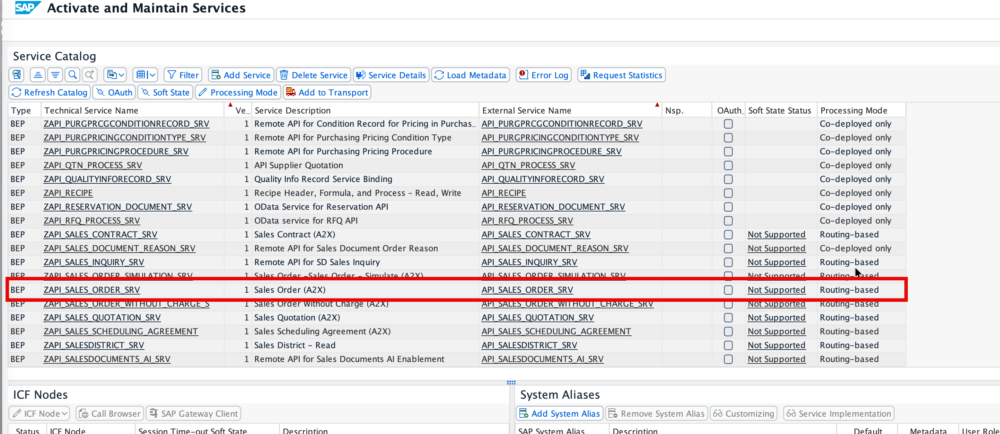

6. On the next screen, set **Package Assignment** to `$TMP` (local object) or a transport package as appropriate, then click the checkmark to confirm.

   > **Optional:** Check **Enable OAuth for Service** if you plan to use OAuth authentication for the BTP Destination.

### Step 1.3 — Verify the Activated Service

7. Navigate to transaction `/IWFND/GW_CLIENT` and execute a test request:

   ```
   /sap/opu/odata/SAP/API_SALES_ORDER_SRV/A_SalesOrder?$top=1&$format=json
   ```

   A successful **HTTP 200** response confirms the service is live.

---

## Part 2 — Create a Technical User and Assign Authorizations

A dedicated technical user is required for BTP to authenticate against the OData service.

### Step 2.1 — Create the Technical User

1. Execute transaction **SU01**.
2. Enter a new **User ID** (e.g. `ZSOAPI_USER`) and click **Create**.
3. On the **Logon Data** tab, set **User Type** to `System` (for background/technical use) and assign a password.

   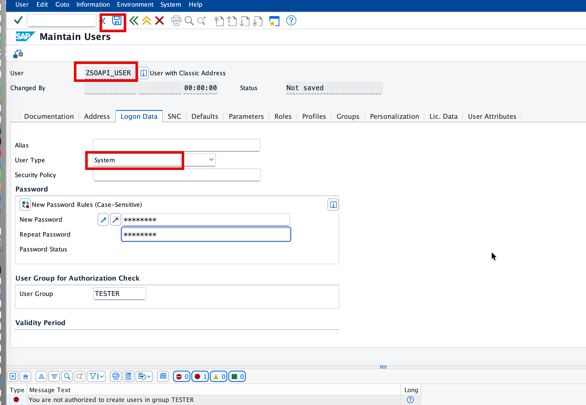

   > **Important:** Note this password — you will need it when configuring the BTP Destination in Part 4.

4. Click **Save**.

### Step 2.2 — Create a Role and Add Authorization Defaults

5. Execute transaction `/nPFCG`. Enter a new role name (e.g. `ZSALESORDER`) and click **Create**.

6. On the **Menu** tab, click the **Authorization Default** dropdown and select **Authorization Default**.

   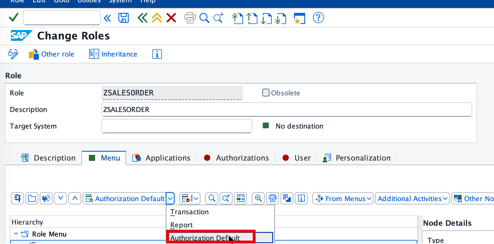

7. In the **Authorization Default** dialog, set the dropdown to **SAP Gateway: Service Groups Metadata**. In the **TADIR Service** table, enter `ZAPI_SALES_ORDER_SRV_0001` and click **Apply**.

   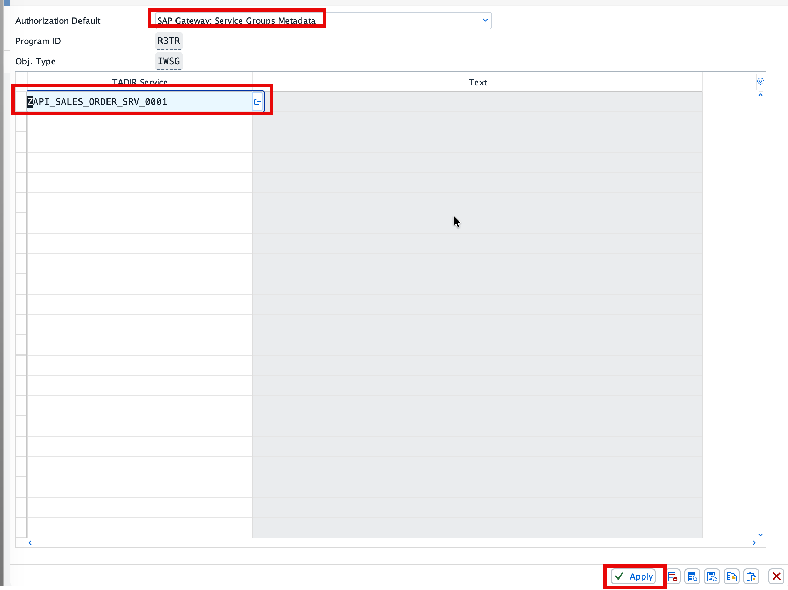

### Step 2.3 — Generate the Authorization Profile

8. Click the **Authorizations** tab. Under **Edit Authorization Data and Generate Profiles**, click the **Change Authorization Data** (pencil) button.

   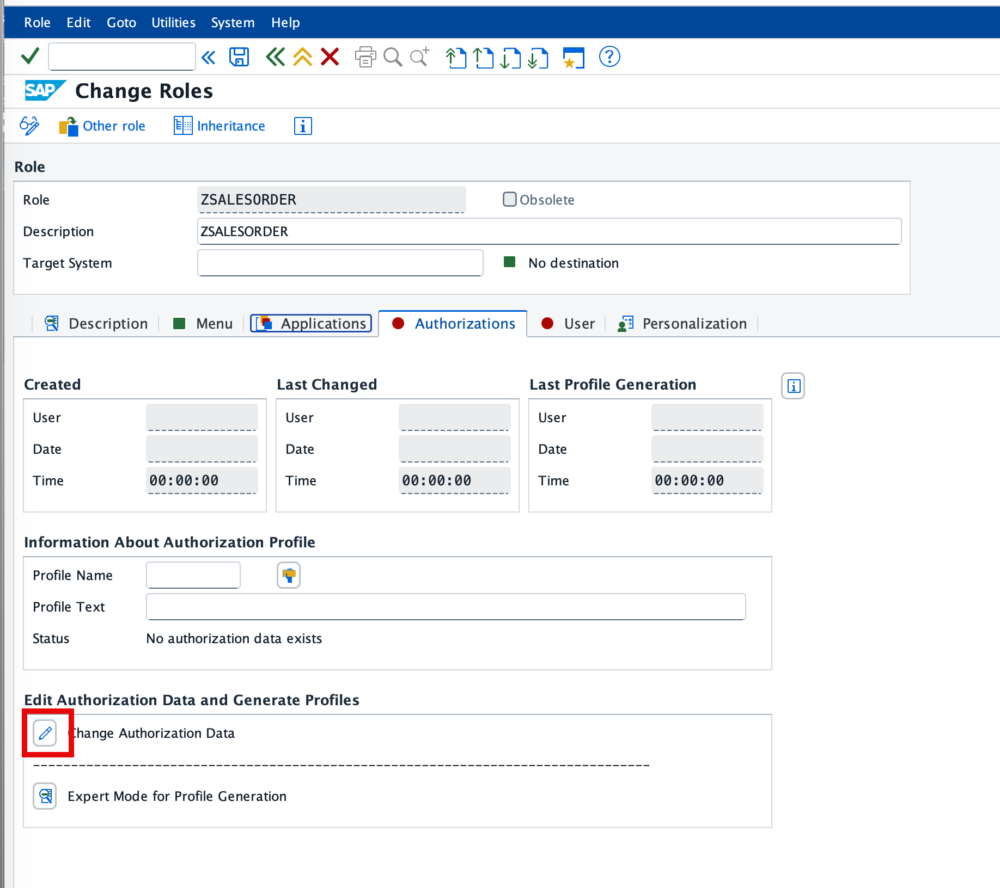

9. In the **Change Authorization Data** screen, go to **Edit** → **Insert authorization(s)** → **From template...**.

   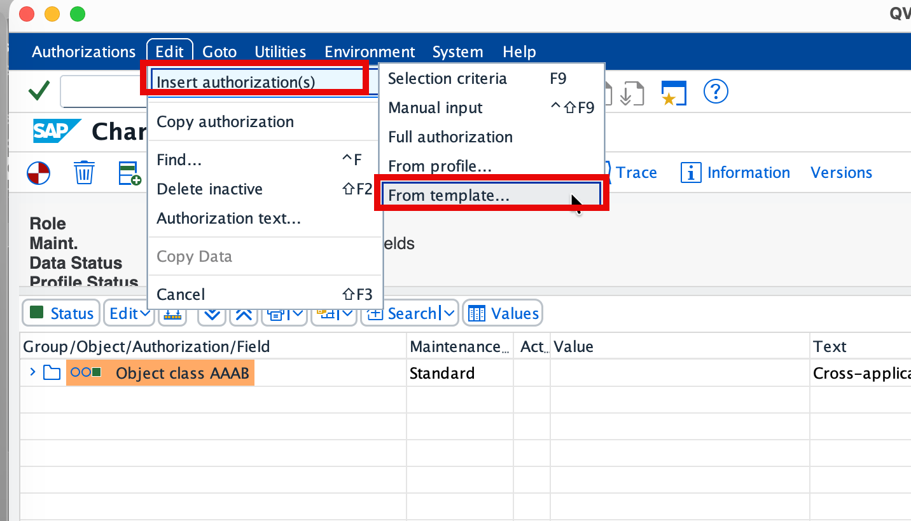

10. In the **Choose Template** dialog, select `/IWFND/RT_GW_USER` (**Template for SAP Gateway User**) and click the checkmark to confirm.

    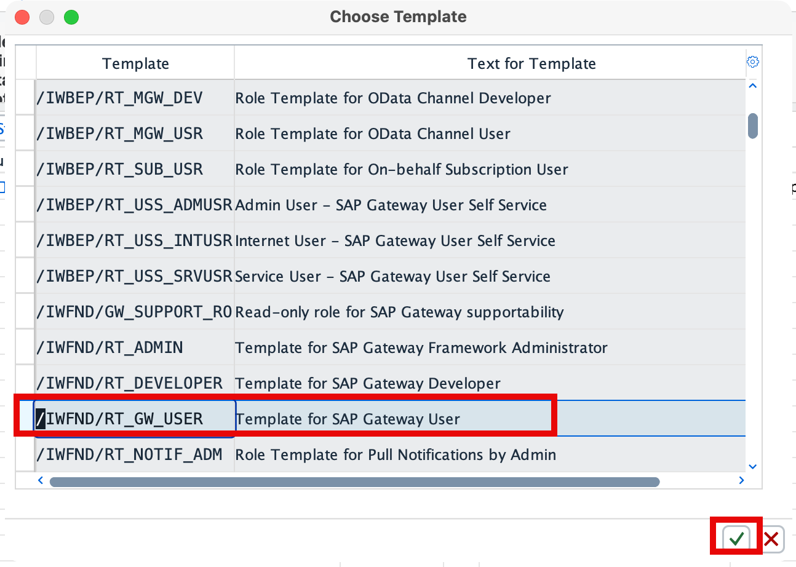

11. Click the **Save** button (①) in the toolbar, then click the **Generate** button (②) to generate the authorization profile.

    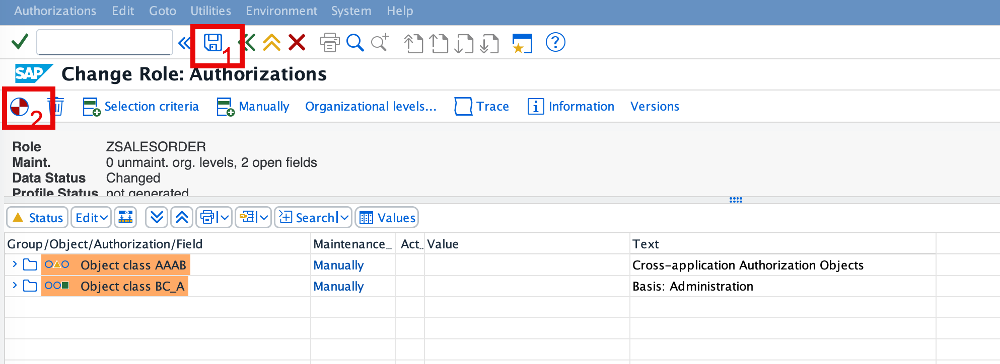

### Step 2.4 — Assign the Role to the Technical User

12. Navigate back to the role in `/nPFCG`. Click the **User** tab.
13. Enter `ZSOAPI_USER` in the **User ID** field and click **Save**.
14. Click **User Comparison** to activate the profile assignment.

    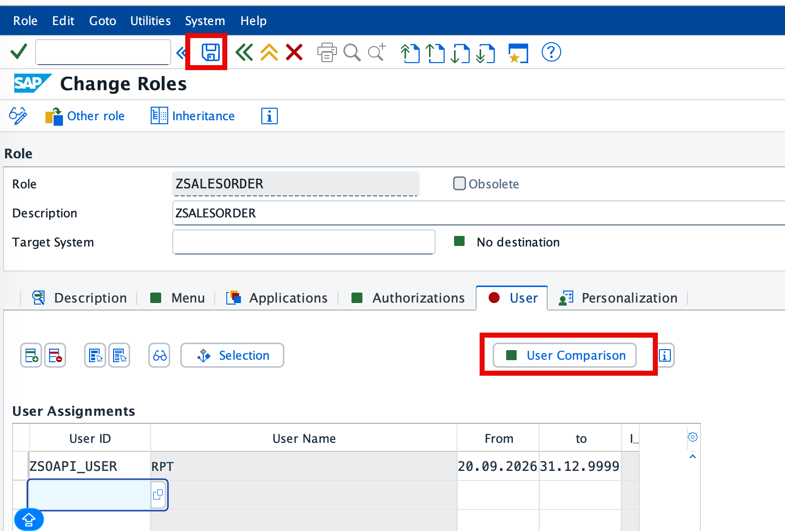

> **Communication Scenario:** The relevant communication scenario for the Sales Order API is `SAP_COM_0109`, which exposes the service at `/sap/opu/odata/sap/API_SALES_ORDER_SRV`. If your on-premise system supports Communication Arrangements, you may alternatively create one for `SAP_COM_0109` following the standard setup guide on the SAP Help Portal.

---

## Part 3 — Configure SAP Cloud Connector

The Cloud Connector creates a secure tunnel between your on-premise S/4HANA system and SAP BTP without opening inbound firewall ports.

### Step 3.1 — Add Your BTP Subaccount

1. Access the Cloud Connector administration UI (typically at `https://localhost:8443`).
2. Go to **Connector** → **Add Subaccount** and fill in the following values:

   | Field               | Value                                                                   |
   | ------------------- | ----------------------------------------------------------------------- |
   | **Region**          | Your BTP subaccount region (e.g. `Europe – Frankfurt`)                  |
   | **Subaccount**      | The GUID/ID of your BTP subaccount (from BTP Cockpit → **General** tab) |
   | **Display Name**    | Any descriptive name (e.g. `jackyscc`)                                  |
   | **Subaccount User** | BTP Cockpit login email                                                 |
   | **Password**        | BTP Cockpit login password                                              |
   | **Location ID**     | A unique ID for this connector (e.g. `jackyscc`) — note this value      |

3. Click **Save**.

### Step 3.2 — Add a System Mapping

4. Under your subaccount, go to **Cloud To On-Premise** → **Access Control** → **(+)**.
5. Configure the system mapping as follows:

   | Field                      | Value                                                                 |
   | -------------------------- | --------------------------------------------------------------------- |
   | **Backend Type**           | `ABAP System`                                                         |
   | **Protocol**               | `HTTPS`                                                               |
   | **Internal Host**          | Hostname or IP of your S/4HANA system (e.g. `ldciqvl.devsys.net.sap`) |
   | **Internal Port**          | HTTPS port of your S/4HANA system (e.g. `44300`)                      |
   | **Virtual Host**           | A name of your choice (e.g. `qvl`) — **note this value**              |
   | **Virtual Port**           | A port of your choice (e.g. `44301`) — **note this value**            |
   | **Principal Type**         | `None`                                                                |
   | **Host in Request Header** | `Use Internal Host`                                                   |

6. Click **Check Availability** in the Actions column. The **Check Result** column should show **Reachable**.

   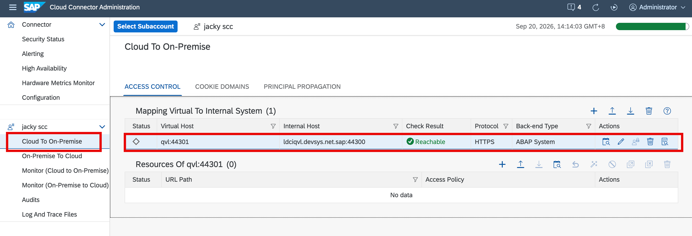

### Step 3.3 — Add an OData Resource

7. Click the system mapping row to select it. Under **Resources Of \<virtual-host\>**, click **(+)** and enter:

   | Field             | Value                    |
   | ----------------- | ------------------------ |
   | **URL Path**      | `/sap/opu/odata`         |
   | **Active**        | Checked                  |
   | **Access Policy** | `Path And All Sub-Paths` |

   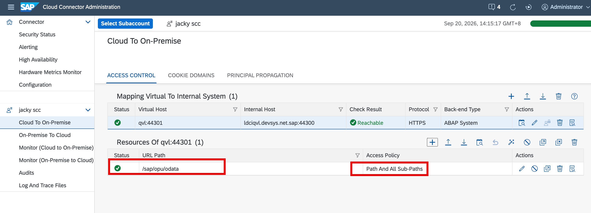

   This permits all OData service calls under `/sap/opu/odata` to pass through the tunnel.

### Step 3.4 — Verify in BTP Cockpit

8. Open the [SAP BTP Cockpit](https://cockpit.btp.cloud.sap) and navigate to your subaccount → **Connectivity** → **Cloud Connectors**. Confirm the connector entry appears with your Location ID and the virtual host listed as **Available**.

   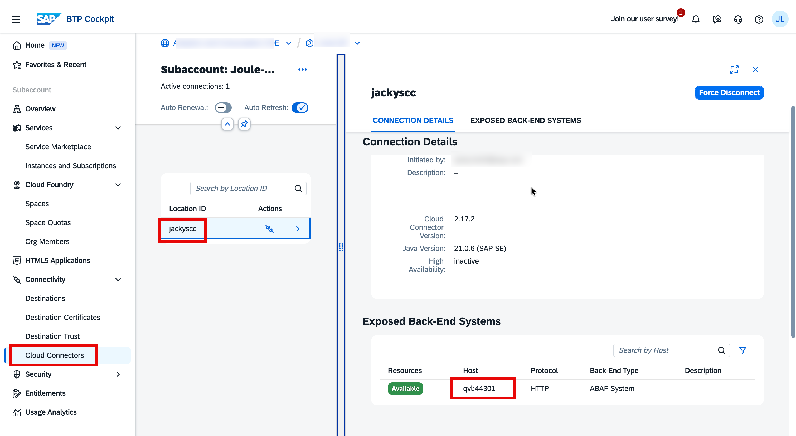

---

## Part 4 — Create a Destination in SAP BTP

With the Cloud Connector tunnel in place, create an HTTP Destination in your BTP subaccount so the CAP application can reach the Sales Order API.

### Step 4.1 — Open the Destination Editor

1. In the BTP Cockpit, navigate to your subaccount → **Connectivity** → **Destinations**.
2. Click **New Destination**.

### Step 4.2 — Configure Main Properties and Authentication

3. Fill in the destination details as follows:

   | Property           | Value                                                            |
   | ------------------ | ---------------------------------------------------------------- |
   | **Name**           | `S4_SO`                                                          |
   | **Type**           | `HTTP`                                                           |
   | **Description**    | `SAP S/4HANA Sales Order API`                                    |
   | **URL**            | `http://<virtual-host>:<virtual-port>` (e.g. `http://qvl:44301`) |
   | **Proxy Type**     | `OnPremise`                                                      |
   | **Authentication** | `BasicAuthentication`                                            |
   | **User**           | `ZSOAPI_USER` (technical user created in Part 2)                 |
   | **Password**       | Password of the technical user                                   |
   | **Location ID**    | The Location ID set in Cloud Connector (e.g. `jackyscc`)         |

   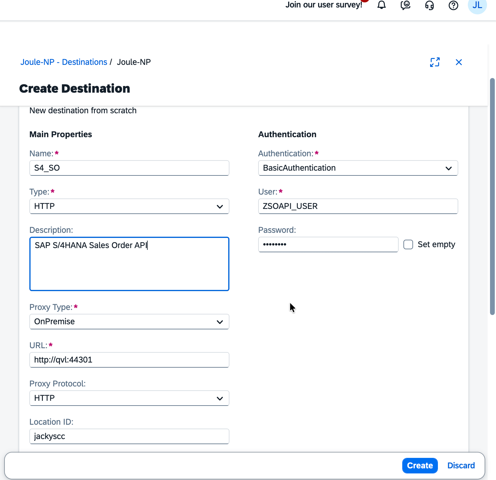

### Step 4.3 — Add Additional Properties

4. Under **Additional Properties**, click **New Property** and add the following entries:

   | Property Key | Value                               |
   | ------------ | ----------------------------------- |
   | `sap-client` | Your SAP client number (e.g. `100`) |

5. Click **Save**.

---

## Part 5 — Test and Validate

### Step 5.1 — Test the BTP Destination

1. In the **Destinations** list, locate **S4_SO** and click **Check Connection**.
2. A `200 OK` or "Connection established" message confirms successful connectivity.

### Step 5.2 — Validate the API Response via BTP

3. From any BTP-connected application or API test tool, call:

   ```
   <destination-url>/sap/opu/odata/SAP/API_SALES_ORDER_SRV/A_SalesOrder?$top=3&$format=json
   ```

   You should receive a JSON response containing Sales Order records.

### Step 5.3 — Test Directly via the SAP Gateway Client

4. In S/4HANA, run transaction `/IWFND/GW_CLIENT`.
5. Enter the request URI:

   ```
   /sap/opu/odata/SAP/API_SALES_ORDER_SRV/A_SalesOrder?$top=1&$format=json
   ```

6. Click **Execute** — expect **HTTP 200** with Sales Order data in the response body.

### Step 5.4 — CSRF Token (for Write Operations)

> For creating or modifying sales orders via POST requests, first fetch a CSRF token with a GET request that includes the header `x-csrf-token: fetch`, then pass the returned token value in the `x-csrf-token` header of your POST request.

---

## Troubleshooting

| Symptom                                                        | Resolution                                                                                                              |
| -------------------------------------------------------------- | ----------------------------------------------------------------------------------------------------------------------- |
| `/IWFND/MAINT_SERVICE` shows no results for `API_SALES_ORDER*` | Confirm the Sales and Distribution (SD) module is active and the backend system alias is set to `LOCAL`                 |
| Cloud Connector Check Result shows **Unreachable**             | Verify the internal hostname and port are correct and that the S/4HANA HTTPS port is open from the Cloud Connector host |
| BTP Destination Check Connection fails with 401                | Confirm the `ZSOAPI_USER` password in the destination matches the one set in SU01                                       |
| BTP Destination Check Connection fails with 404                | Confirm the resource `/sap/opu/odata` is added in Cloud Connector with **Path And All Sub-Paths**                       |
| BTP Cockpit → Cloud Connectors shows no entry                  | Confirm the Location ID in the Cloud Connector matches the one entered in the destination                               |

---

## Summary

You have completed the full integration between SAP S/4HANA On-Premise / PCE and SAP BTP:

| Artifact                       | Where           | Purpose                                                                            |
| ------------------------------ | --------------- | ---------------------------------------------------------------------------------- |
| OData service activated        | SAP S/4HANA     | `API_SALES_ORDER_SRV` exposed via SAP Gateway (transaction `/IWFND/MAINT_SERVICE`) |
| Role `ZSALESORDER`             | SAP S/4HANA     | Contains SAP Gateway User authorization (`/IWFND/RT_GW_USER`)                      |
| Technical user `ZSOAPI_USER`   | SAP S/4HANA     | Provides credentials for Basic Authentication from BTP                             |
| Cloud Connector system mapping | Cloud Connector | Tunnels traffic from BTP to the on-premise S/4HANA host via virtual host `qvl`     |
| Destination `S4_SO`            | SAP BTP         | Allows CF applications to call `API_SALES_ORDER_SRV` via the Destination service   |

| Key Reference                | Value                                    |
| ---------------------------- | ---------------------------------------- |
| OData Service                | `API_SALES_ORDER_SRV`                    |
| Activation Transaction       | `/IWFND/MAINT_SERVICE`                   |
| Communication Scenario       | `SAP_COM_0109`                           |
| OData Base Path              | `/sap/opu/odata/SAP/API_SALES_ORDER_SRV` |
| BTP Destination Proxy Type   | `OnPremise`                              |
| BTP Authentication           | `BasicAuthentication`                    |
| SAP Business Accelerator Hub | `OP_API_SALES_ORDER_SRV_0001`            |

Applications running in your BTP Cloud Foundry space can now use the Destination service to call the Sales Order OData V2 API through the Cloud Connector tunnel.
